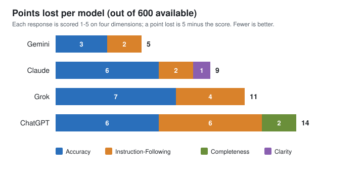

# AI Response Evaluation

A benchmark comparing how four AI models answer the same 30 prompts, scored 1–5 on **accuracy**, **instruction-following**, **completeness** and **clarity** using a written rubric.

**Quick links:** [Final analysis](analysis/final-analysis.md) · [Browse all responses](responses/README.md) · [Rubric](scores/rubric.md) · [Methodology](docs/methodology.md) · [Scores (CSV)](scores/scores.csv)

## Models

| Provider | Model | Access | Settings |
|---|---|---|---|
| Google Gemini | Gemini 4 Hydrogen | Website | Everyday Help |
| OpenAI ChatGPT | Default model (version not disclosed) | Website | Default settings |
| xAI Grok | Default model (version not disclosed) | Website | Fast |
| Anthropic Claude | Claude Sonnet 5.5 | Website | Low effort |

All responses were collected on 2026-11-13.

## Results at a glance

Mean score across the four dimensions (30 responses per model, scale 1–5):

| Model | Mean | Responses scored 5 on every dimension |
|---|:-:|:-:|
| Gemini | 4.96 | 26 / 30 |
| Claude | 4.92 | 24 / 30 |
| Grok | 4.91 | 25 / 30 |
| ChatGPT | 4.88 | 22 / 30 |

- 454 of the 480 individual scores are a 5. Almost every deduction is in accuracy or instruction-following.
- Typical deductions are a wrong detail inside an otherwise correct answer, or a missed explicit constraint such as citing sources or giving only one example.
- All four models correctly rejected the false premises in the prompts that had them, and none invented results when asked to do something they could not do.

The gaps are small and come from a single human evaluator (with AI-assisted rubric review) and a limited sample, so these numbers are not a ranking of which model is best. See [`analysis/final-analysis.md`](analysis/final-analysis.md) for the per-dimension breakdown, error patterns and limitations.

## Repository layout

| Path | Contents |
|---|---|
| `prompts/` | The 30 prompts, `P01.txt` to `P30.txt`. |
| `responses/` | Each model's response, saved exactly as returned: `responses/Pxx/{grok,chatgpt,gemini,claude}.md`. [`responses/README.md`](responses/README.md) is a clickable index. `responses/collection-log.csv` records the model, access method, settings and date for every response. |
| `scores/rubric.md` | The 1–5 definitions for each dimension and the scoring principles. |
| `scores/scores.csv` | One row per response: four scores and a note explaining every deduction. |
| `analysis/final-analysis.md` | Results, error patterns, scoring decisions and limitations. |
| `docs/methodology.md` | How the benchmark was designed, collected and scored. |
| `tools/` | The local scoring tool (`scorer.py`) and the script that regenerates the chart and response index (`make_chart.py`). |

## Scoring tool

Run `python tools/scorer.py` and the scoring page opens in your browser. It shows one response at a time (model names hidden until all four scores are set), and every score is written straight to `scores/scores.csv`. Re-running resumes where you left off. Requires Python 3 only.

If you edit `scores/scores.csv` by hand, restart the tool afterwards: it loads the file once on startup and will overwrite outside edits the next time it saves.

To rebuild the chart and the response index after changing scores, run `python tools/make_chart.py`.

## Notes

- Scores were produced by the evaluator together with an AI assistant (Claude); the evaluator reviewed and approved every final score. See `docs/methodology.md`.
- Responses are stored verbatim as `.md` files, so GitHub renders their formatting. They include any copy-paste artifacts from the websites (such as broken image links, doubled backslashes in LaTeX, or unfenced code that renders as headings), which were deliberately left unedited and not counted against the models.
- Results reflect the models only as they behaved on the collection date.
